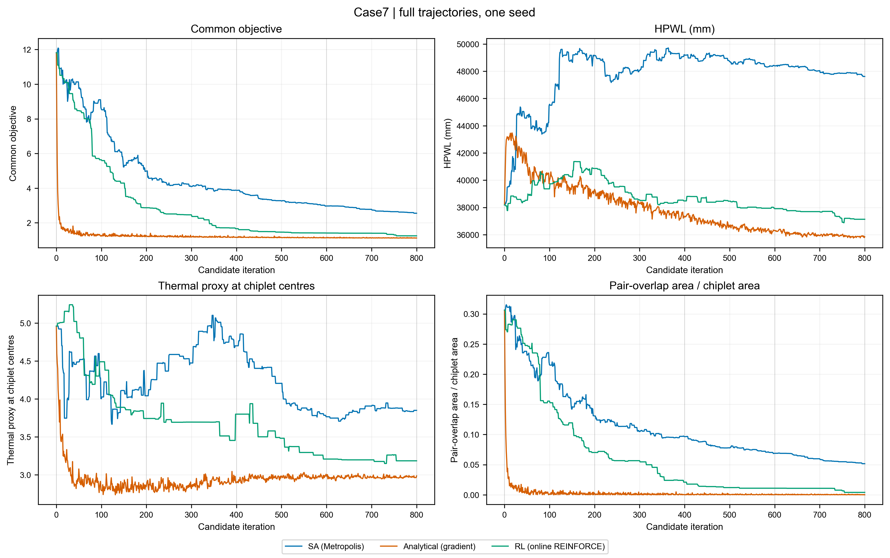
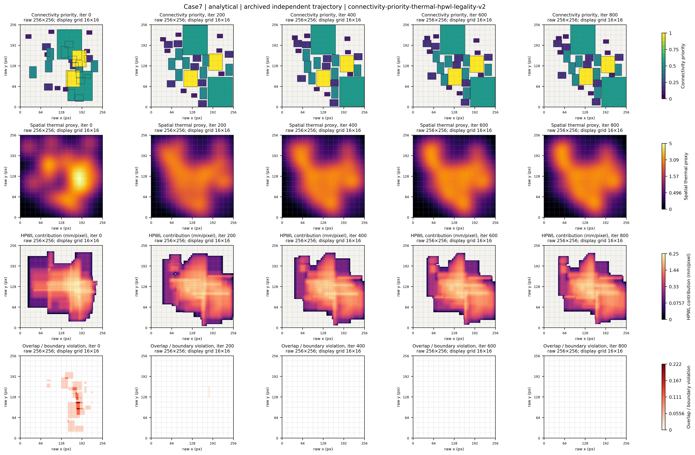
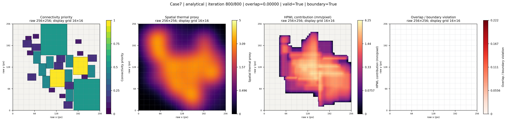

# 2.5D Chiplet：阶段0可视化展示

本仓库仅公开立项答辩PPT第9–11页涉及的阶段0可视化：Case7三算法指标对比、五检查点、四通道状态流，以及Case1–10终态标量。

完整研发仓库已私有化。本仓库为独立新历史；不包含Agent/CNN/LLM实现、算法选择配置库、同状态标签、训练代码、研究计划、审核日志或答辩PPT本体。

直接打开[index.html](index.html)查看。GitHub文件页面也可浏览assets中的PNG。

## 数据与解释

使用既有Stage0归档，三个本地算法族（SA、投影梯度、在线REINFORCE）各800候选，检查点0/200/400/600/800。它们不是外部论文官方实现。所有热图是未校准空间代理，不是温度。Case4原几何面积不可行，不纳入9Case效果汇总；非法终态不能据此宣称算法优化有效或优于其他方法。

四通道依次为priority（关联pin数归一化，背景-1）、thermal_proxy、HPWL contribution（mm/pixel）、legality（重叠/越界空间诊断）。原始张量为4×256×256。色彩图不是物理最优性或因果解释证明。

## 运行可视化代码

```powershell
python -m pip install -r requirements.txt
python render_maps.py --algorithm analytical --step 800 --output build/Case7_analytical_0800.png
```

render_maps.py只读取公开的预计算地图重绘，不运行优化器或训练。输出300DPI、nearest显示、16×16宏网格；样式与原归档图可能不同。原PPT风格图直接见assets。数据字段和公开文件哈希见PUBLIC_FILES.json。

## 发布边界

后续更新仅限经审核的阶段0可视化白名单。不得向这里推送完整研发分支/历史、工作树、私有配置或后续实验。新增公开内容需重新审查。

## 图像预览






